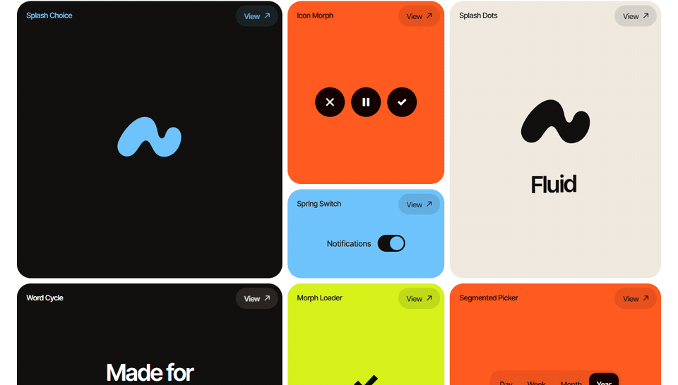

# Fluid

**Your brand, in motion.** Open-source motion for React, built on one idea: outlines that flow on real springs. Shapes become your logo, pills flow between options, words come out of a blur, and windows grow out of the card that opened them. Every piece wears your logo, colours and font.

[Documentation](https://fluidui.willradoux.com/docs) · [Components](https://fluidui.willradoux.com/components) · [Mascots](https://fluidui.willradoux.com/mascots) · [Changelog](CHANGELOG.md)

[](https://github.com/useFluid/fluidui/actions/workflows/ci.yml)
[](https://www.npmjs.com/package/@usefluid/motion)
[](LICENSE)



Fluid has three parts:

- **An engine**, `@usefluid/motion`: closed-form springs and **Metamorph**, contour morphing between any two shapes or logos. No dependencies.
- **Pieces** you copy into your project with the CLI: openings, controls, characters, text and transitions, all made with the engine.
- **Agent skills** that teach your coding agent to set up your brand, pick and adapt pieces, build new ones and record them as video.

## Pieces

| Family | Pieces |
|---|---|
| Metamorph | Shape Morph, Icon Morph, Menu Morph, Morph Dialog, Morph Button, Copy Morph, Morph Loader |
| Characters | Pet, Bot, Mascot |
| Controls | Segmented Picker, Pill Tabs, Spring Switch, Spring Button, Morph Island |
| Text | Word Cycle, Text Reveal |
| Transitions | Logo Wipe, Island Toast |
| Splash | Splash Choice, Splash Shapes, Splash Dots |

Every piece:

- reads ten `--fluid-*` CSS variables, so it wears your brand;
- has 44 px touch targets and a visible focus ring;
- works with the keyboard and tells screen readers what changed;
- goes straight to its final state when the system asks for reduced motion;
- fits on a 320 px screen, and is tested in Chromium and WebKit, the engine behind Safari.

Each piece folder has a README with an example, its props and its accessibility notes.

## Quick start

```bash
npm i @usefluid/motion
npx @usefluid/cli init --out src/styles/fluid-theme.css
npx @usefluid/cli logo logo.svg --out src/lib/logo.ts
npx @usefluid/cli add splash-choice morph-dialog
```

| Command | What it does |
|---|---|
| `init` | Writes the theme file with the ten variables. Point them at your own tokens. |
| `logo` | Converts an SVG logo into the single path, in a 120 x 120 box, that the pieces use. |
| `add` | Copies pieces into `src/components/fluid/`, with any piece they depend on. From then on they are your code. |
| `record` | Records any page as an MP4, frame by frame at 60 fps, in story, post, square or wide format. Needs `playwright-core`, Chrome or Edge, and `ffmpeg`. |

The engine on its own:

```tsx
import { shapes } from "@usefluid/motion";
import { MorphPath, useSpring } from "@usefluid/motion/react";

<svg viewBox="0 0 120 120">
  <MorphPath d={open ? logo : shapes.circle} fill="currentColor" />
</svg>;

useSpring({ x: open ? 200 : 0 }, ({ x }) => {
  el.current.style.transform = `translateX(${x}px)`;
});
```

Full API: [packages/motion](packages/motion/README.md) and [packages/cli](packages/cli/README.md).

## Agent skills

```bash
npx skills@latest add useFluid/fluidui
```

| Skill | For |
|---|---|
| `fluid-brand` | Finds the logo, colours and font, and writes the theme |
| `fluid-components` | Picks the right piece and adapts it |
| `fluid-metamorph` | Builds new pieces with the engine |
| `fluid-splash` | Builds a product opening from the logo |
| `fluid-characters` | Pets, bots and mascots with moods tied to the product |
| `fluid-video` | Records pages and pieces as video |
| `fluid-ai-video` | Puts brand motion over AI-generated video |

They only start when the project uses Fluid or you ask for it by name. More in [skills](skills/README.md).

Agents can also read the docs directly: every piece page is plain Markdown with `.md` at the end of its address, and [llms.txt](https://fluidui.willradoux.com/llms.txt) lists them all.

## Repository

```
packages/
  motion/        the engine: springs, Metamorph and React bindings
  cli/           the fluid CLI
registry/        the pieces, one folder each: component, styles, demo and README
  index.ts       the catalogue: name, family, texts and agent prompt of each piece
  brands.ts      the example brands used in the demos
skills/          the agent skills
apps/site/       the docs and showcase site, in English and Portuguese
scripts/         packaging, recording and scaffolding
```

## Development

```bash
npm install
npm run dev
npm test
npm run typecheck
npm run build && npm run test:e2e
npm run new -- my-piece
node scripts/build-packages.mjs
```

| Script | What it does |
|---|---|
| `dev` | The site at http://localhost:3000 |
| `test` | Engine and catalogue tests |
| `test:e2e` | The site in a real browser, on Microsoft Edge |
| `new` | A new piece with its component, demo and README |
| `build-packages` | Builds the engine and the CLI into `dist/` and packs them into `pack/` |

See [CONTRIBUTING](CONTRIBUTING.md) for what every piece needs, and the [code of conduct](CODE_OF_CONDUCT.md). Security problems go through [SECURITY](SECURITY.md).

## License

[MIT](LICENSE)
